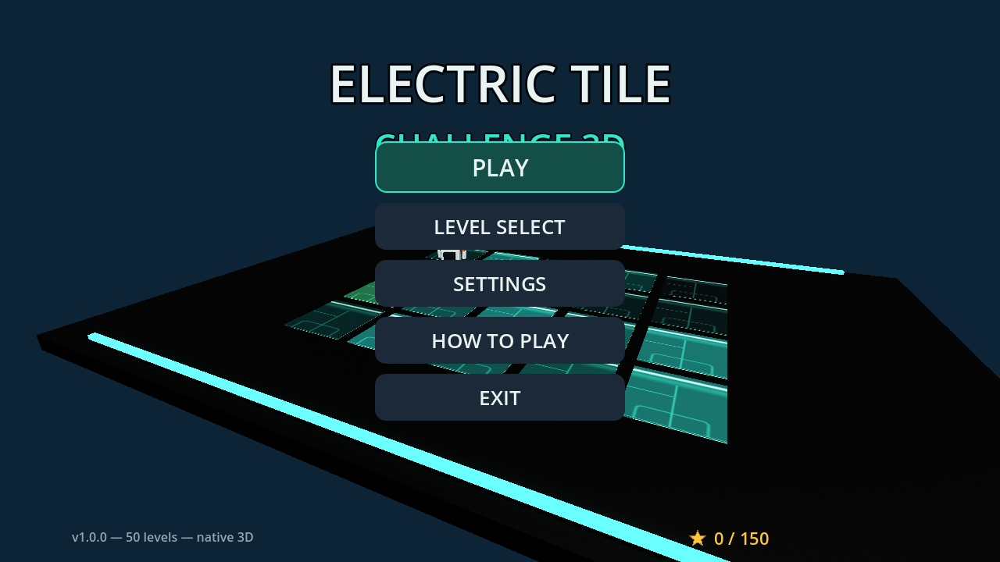
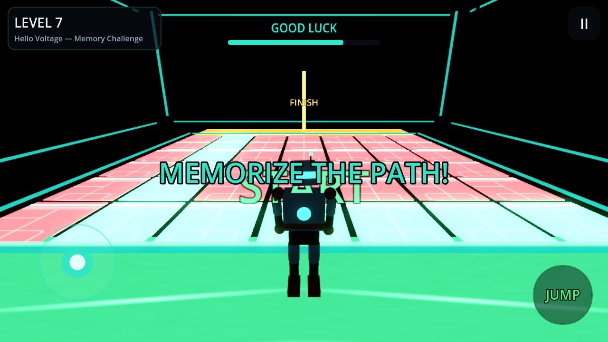

# Electric Tile Challenge 3D

A **native 3D Android game** built with **Godot 4.3** — you memorize the glowing safe
path across an electrified tile floor, then cross it in the dark. One wrong tile and
you get zapped back to the start.

- 50 playable levels across 5 difficulty tiers (Beginner → Master)
- 3 challenge modes: **Memory**, **Timed**, and **Pattern** (exact-order sequences)
- Master-tier **flipper hazards** that alternate between safe and lethal
- Full 3D third-person character, physics, jump, camera rig (smart-follow + manual orbit)
- Mobile-first touch controls: virtual joystick, jump button, drag-to-look, pinch zoom
- Full audio: synthesized SFX + looping music, separate music/SFX volume settings
- Low / Medium / High graphics presets — photoreal pipeline on capable
  devices: Forward+ renderer, SDFGI global illumination, SSR reflections,
  volumetric light shafts, SSAO, TAA, filmic post FX (vignette / chromatic
  aberration / grain), real CC0 photoscan PBR materials
- Level progression, 1–3 star ratings, best times, persistent save data

**Repo:** https://github.com/psfaruk/electric-tile-challenge-3d

## Screenshots

Rendered automatically by CI on every push (Forward+ via lavapipe Vulkan,
HIGH quality) — see the `Game-Screenshots` artifact for the latest.

| Main menu (live 3D attract mode) | Gameplay — memorize phase (level 7) |
|---|---|
|  |  |

## Download / Build

The APK is built by **GitHub Actions** on every push:

1. Go to the **Actions** tab → latest **Build Android APK** run → **Artifacts** →
   download `ElectricTileChallenge3D-APK`.
2. Tagged releases (e.g. `v1.0.0`) publish the APK as a GitHub **Release** for
   one-tap download on your phone.
3. Copy to your Android 9.0+ (Vulkan) device, allow "install unknown apps"
   for your browser/file manager, install, play. Older devices without Vulkan
   still run the game via the automatic Compatibility (GLES3) fallback.

See [docs/ANDROID_BUILD.md](docs/ANDROID_BUILD.md) for the full pipeline, the demo
signing key discussion, and local-build instructions.

## Controls

| Action | Android | Desktop (testing) |
|---|---|---|
| Move | Left virtual joystick | WASD / arrows |
| Jump | Right JUMP button | Space |
| Camera | Drag right side of screen | Drag (touch emulation) |
| Zoom | Pinch | Mouse wheel |
| Pause | Back button / II button | Esc |

## The 50 levels

Levels are pure data (`data/levels/level_001.json` … `level_050.json`) loaded at
runtime — no level is hardcoded. Every config is validated in CI by
`scripts-dev/validate_levels.gd` (bounds, connectivity, timing sanity), and the full
gameplay loop is exercised headlessly by the smoke test on every push.

Details: [docs/LEVEL_DESIGN.md](docs/LEVEL_DESIGN.md)

## Development quality gates (CI)

Every push must pass:

1. `godot --headless --import` — compiles every script in the project
2. `--check-only` syntax pass on every `.gd` file
3. **All 50 level configs validated** (exit code gate)
4. **Headless gameplay smoke test**: boot → memorize → walk the safe path →
   victory → retry → deliberately step on a hazard → fail flow → all screens
   (menu, level select, settings) — zero script errors allowed
5. Signed release APK export + artifact upload
6. (non-blocking) software-GL screenshot render of menu + gameplay

See [docs/TEST_REPORT.md](docs/TEST_REPORT.md) for the honest status of on-device
testing.

## Project layout

```
project.godot                 # Godot 4.3 project config (mobile renderer, landscape)
export_presets.cfg            # Android export preset (icons, keystore, ABI)
autoload/                     # GameState (save/settings) + AudioManager
scenes/main.tscn              # the single scene; everything else is code-built
scripts/
  main.gd                     # screen router + fade transitions
  game/                       # grid math, arena, tiles, sparks, robot, player,
                              # camera rig, challenge referee, graphics presets
  ui/                         # UI factory + screens (menu, levels, settings,
                              # gameplay HUD) + widgets (joystick, icons)
data/levels/                  # 50 JSON level configs
assets/textures|audio|icons   # 100% original, generated via scripts-dev/*.py
android_signing/              # demo release keystore (see docs before shipping!)
scripts-dev/                  # asset generators + CI validators (python + GDScript)
.github/workflows/            # Android build pipeline
docs/                         # architecture, gameplay, levels, assets, build, tests
```

## Asset licensing

Everything in this repository is original and authored for this project:

- Textures: `scripts-dev/gen_textures.py` (procedural, CC0)
- Sounds/music: `scripts-dev/gen_audio.py` (synthesized, CC0)
- Icons: `scripts-dev/gen_icons.py` (procedural, CC0)
- Character/arena/tiles: generated at runtime by GDScript (procedural primitives
  with hand-designed proportions, materials and animation curves)

No third-party assets are used, so the APK ships fully licensed.

## Multi-agent development

This project was built by a coordinated agent team (see
[docs/PHASE_PROGRESS.md](docs/PHASE_PROGRESS.md)): Technical Architect /
Integration Lead / Engine / Gameplay / UI / Audio agents (core), plus dedicated
Level Designer and Icon Artist agents for content — with a single source of truth
for architecture and a CI integration gate for every contribution.
